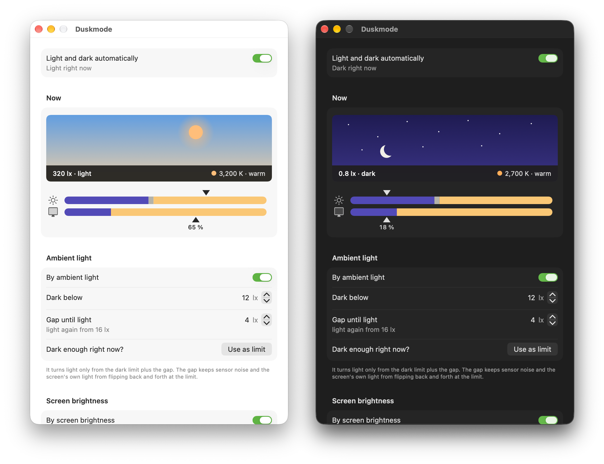

# Duskmode

**Automatic dark mode for your Mac – driven by the light in your room, not by the clock.**

macOS can switch to dark mode at sunset. But your room doesn't care about sunset: blinds down at noon, a dim
desk lamp at 4 pm, a bright office at night. Duskmode reads the Mac's ambient light sensor and switches the
system appearance when it actually gets dark around you – and back when it gets light again.

<p align="center"></p>

## Features

- **Switches by ambient light** – dark below a threshold you choose, light again above threshold + gap.
- **Optionally by screen brightness** – a very dim screen can count as "dark" too. Each criterion has its own switch.
- **Respects you** – switch the appearance by hand and Duskmode backs off until the light really changes.
- **Live view** – a little sky with the current light level and the *colour* of the light (e.g. "2,800 K · warm"),
  plus two bars that show where you are relative to your thresholds.
- **Invisible** – no Dock icon, no menu bar icon (optional). Open the app again to get the settings window.
- **Light on energy** – see below. No network, no tracking.
- **English and German**, picked automatically from your system language.

## How it works

The sensor next to the camera is the same one macOS uses for auto-brightness and True Tone. It is a colour light
sensor (a single measuring point, not an image) and reports the illuminance in lux plus the colour of the light.

- Below **"Dark below"** it switches to dark. It switches back to light only above **"Dark below" + "Gap"**.
  The gap is not a delay – it stops sensor noise and the light of your own screen (which the sensor also sees)
  from flipping the appearance back and forth right at the threshold.
- With **screen brightness** enabled, a screen below your percentage counts as dark as well. It turns dark as soon
  as either criterion says dark.
- If you change the appearance yourself, Duskmode pauses until the light crosses to the other side.
- With the lid closed (external display only) it doesn't measure – the sensor is covered.
- macOS' own *Appearance: Auto* would fight with it, so Duskmode turns that off while it runs and restores it when
  you quit.

## Energy

The sensor runs anyway (macOS reads it about 2.6 times per second for brightness and True Tone); one extra look
costs about 40 µs. Duskmode looks every 20 seconds (with 10 s tolerance so macOS can batch the wake-ups), right away
when the screen brightness changes (macOS reports that), and not at all while the screen is off. That's roughly
4,300 looks a day, about 0.2 s of CPU time in total. Only while the settings window is open does it measure ten
times per second, for the live view and an instant reaction.

## Requirements

- A Mac with a **built-in display and ambient light sensor** – MacBook Air / MacBook Pro, probably the iMac too
  (untested). Mac mini and Mac Studio have no light sensor.
- **Apple Silicon** and **macOS 14** or later.
- So far tested on one machine (MacBook Pro M5, macOS 27). Reports from other Macs are very welcome.

## Install

1. Download `Duskmode-x.y.z.zip` from [Releases](../../releases), unzip it and move **Duskmode.app** to
   *Applications*.
2. Open it. Because the app isn't notarized by Apple, macOS will block the first launch. Go to
   *System Settings → Privacy & Security* and click **Open Anyway** – or run:
   ```bash
   xattr -dr com.apple.quarantine /Applications/Duskmode.app
   ```
3. On first launch Duskmode adds itself as a login item and shows its settings window.

**Using it:** Close the window (⌘W) and Duskmode keeps working invisibly. Open the app again (Spotlight,
Applications) to get back to the settings. Quit (⌘Q or the *Quit* button) stops it until the next login.

## Build from source

Only Apple's Command Line Tools are needed (`xcode-select --install`), no Xcode:

```bash
./app_bauen.sh          # builds and installs /Applications/Duskmode.app
./app_bauen.sh --zip    # builds into dist/ and creates a release zip
```

The whole app is one Swift file, [`Duskmode.swift`](Duskmode.swift). Code comments are in German.

For screenshots there is a demo mode with fixed example values that doesn't touch your system appearance:
`open -n /Applications/Duskmode.app --args -demo day` (or `-demo night`).

## Under the hood

Duskmode uses a few **private Apple APIs**, loaded at runtime so a missing one doesn't crash the app:

| What | Where |
|---|---|
| Ambient light sensor | `BezelServices` (`ALCALSCopyALSServiceClient`), `IOKit` HID events |
| Screen brightness and its change notifications | `DisplayServices` |
| Setting the appearance, turning off *Auto* | `SkyLight` |

This is why it can't be on the Mac App Store, and why a future macOS update could break it. If something goes
missing, the settings window tells you. Settings are stored in `~/Library/Preferences/de.jakobbirkner.duskmode.plist`.

## Uninstall

Quit Duskmode, turn off *Start at login* first if you like (or remove it later under *System Settings → General →
Login Items*), then delete the app and its settings:

```bash
rm -rf /Applications/Duskmode.app && defaults delete de.jakobbirkner.duskmode
```

## Credits

Inspired by [DarkModeBuddy](https://github.com/insidegui/DarkModeBuddy) by Guilherme Rambo, which showed how to read
the ambient light sensor on modern Macs.

## License

[MIT](LICENSE) © 2026 Jakob Birkner

---

### Auf Deutsch

Duskmode schaltet den Mac automatisch in den Dark Mode, wenn es im Raum dunkel wird – nach dem Lichtsensor neben der
Kamera und auf Wunsch nach der Bildschirmhelligkeit, nicht nach der Uhrzeit. Die App läuft unsichtbar im
Hintergrund; die Einstellungen kommen, wenn man sie noch einmal öffnet. Sprache: automatisch Deutsch oder Englisch.
